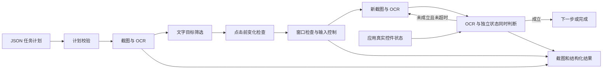

# 感知控制与执行闭环

项目包含感知、控制、流程编排、数据处理和模型接口包，已有脚本保留为各阶段命令行入口。

## 感知层

`gui_perception/pipeline.py` 的 `capture_screen()` 返回原始 RGB 图片与元数据，元数据包含截图区域、显示器信息和物理坐标约定。`create_reader()` 加载一次 EasyOCR Reader，`save_run()` 生成一个独立观察目录。

`normalize_results()` 保留识别框在原图中的位置，并在屏幕截图有已知原点时生成物理桌面坐标。已有图片的桌面坐标为 null，不能直接用于真实点击。

主要结果字段：

| 字段 | 含义 |
|---|---|
| polygon / bbox / center | 相对于原始图片左上角的像素坐标 |
| desktop_polygon / desktop_bbox / desktop_center | 加截图区域偏移后的物理桌面坐标 |
| text / confidence | 识别文字与模型给出的置信度 |
| source.region | 截图区域的 left、top、width、height |

## 控制层

`gui_control/targets.py` 负责匹配与排序，完整匹配时忽略空白、大小写和全半角差异。同名目标需显式选择序号，缺失和重名分别通过 `TargetNotFound`、`AmbiguousTarget` 报告。

`DesktopController` 在发送输入前检查停止状态、鼠标角落停止、目标窗口身份和目标点是否在窗口内。Windows 文本使用 Unicode 输入事件，鼠标、普通按键与快捷键使用 PyAutoGUI，pynput 监听 Escape。

控制日志中的 `sent` 只表示调用已经返回，不能单凭它判断软件状态发生了预期变化。

## 流程编排层

`validate_plan()` 先检查整份任务，强制非空 `expect.state`，返回补齐默认值的副本。`ScreenObserver` 复用 Reader，分别保存 OCR 和独立控件状态；文字点击前重拍目标区域，检查窗口位置和目标图像是否明显变化。`StateFile` 校验状态新鲜度与 HWND；演示程序主线程读取真实控件并导出，未提供适配器时拒绝执行。

`WorkflowRunner` 按步骤观察、执行并检查结果。找不到目标或目标在输入前发生变化时，可以重新观察；一旦开始发送输入，不自动重放，以避免重复输入、重复点击或重复提交。

| 状态字段 | 含义 |
|---|---|
| dispatch_started | 可能已有部分输入发送，不能假设动作完全没有发生 |
| action_sent | 控制调用正常返回 |
| verified | 新截图 OCR 与独立控件状态同时满足预设条件 |
| completed | 全部步骤通过条件确认 |
| failed / aborted | 条件或控制失败，或用户请求中止 |

默认要求预期条件在操作前不成立、操作后成立。等待步骤只观察；显式关闭 transition 的条件仅能说明画面满足要求，不证明变化由当前动作引起。

## 日志和扩展位置

每次运行有独立目录。`summary.json` 保存检查点、分通道验证和分类错误，`events.jsonl` 记录流程事件，`actions.jsonl` 记录输入动作。每次观察保留原图、标注图、OCR JSON 与独立 state.json。状态发布遇到临时访问拒绝时留待下一周期重试，不更新旧时间戳；持续失败仍会触发新鲜度保护。2026-10-26 的 60 项离线测试、两档实际缩放与六组系统场景见 [测试章节](testing.md)；200% 待测。

## 第二周数据与模型接口

`gui_data/` 独立完成官方小样本采集、格式转换、清洗及防泄漏划分，见 [周一完成记录](week2-monday.md)。`gui_agent/` 使用 LangChain Core 将输入准备、HTTP/回放调用、候选校验组合为 RunnableSequence。`agent_cli.py` 接受已有图片或周一数据，保存模型响应与单步候选；它不创建桌面控制器。

模型输入不包含数据集标签；窗口标题及允许的独立状态字段由调用方指定。候选步骤复用 `validate_plan()` 的双重确认契约，同时拒绝模型自建的状态字段与关闭变化检查的动作。候选的 execution_eligible 与 task_verified 均为 false；模型表达 done 不会改变实际任务状态。

周二已用回放和回环 HTTP 模拟服务验证框架与协议，NIM 真实推理仍待测，详见 [周二完成记录](week2-tuesday.md)。后续新增的多步任务拆解与实时执行衔接见以下周三、周四小节。

## 第二周周三规划层

`GuiPlanner` 复用 `GuiAgent` 的 LangChain、HTTP/回放、脱敏、中断与结果保存，通过独立规划提示和解析器处理多步结果。`validate_task_plan()` 检查子任务唯一性、此前依赖引用、总动作数及全局步骤名，然后复用 workflow 和单步契约校验所有动作、键名、独立状态字段与变化条件。

整份计划通过后才输出 `task_plan.json`、`action_sequence.json` 和 `workflow.candidate.json`。动作按子任务数组顺序串行编译，不自动重排或并行调度。周三阶段通过既有 CLI 的 validate-only 检查，实时执行衔接见周四小节。模型意见 done、plan_ready 均不表示任务通过独立验收，详见 [周三完成记录](week2-wednesday.md)。

## 第二周周四执行集成

`AgentSession` 使用同一个 ScreenObserver 取得初始图像、OCR 和独立状态，将当前观测及调用方目标加入规划请求；模型返回后检查停止状态、窗口身份、区域和控件值，再交给 WorkflowRunner 逐步执行。最终再次观察并验证调用方提供的 OCR+state 目标，不以模型自己的 done 或步骤 expect 代替任务级验收。

`run_agent.py` 缺省不发送真实输入，显式 execute 还要求 goal-file；demo 模式使用明确标记的模拟环境。真实模式点击前核对实际指针位置，并通过检查 SendInput 接收数量的路径发送鼠标事件；部分失败只做释放清理、不切换后端重发。旧固定计划入口保留原路径。

本轮模拟与 HTTP 闭环通过。退出游戏后，同一代码在独立演示窗口完成真实三步及最终目标的双重确认，注入 OCR 假阳性也被独立状态正确阻止；此前输入失败证据保留，具体影响组件未确认。真实规划仍为回放，NIM 与更多应用/缩放待测，详见 [周四完成记录](week2-thursday.md)。

## 第二周周五基础任务测试

`gui_tasks/basic.py` 定义五类任务的固定规划、调用方目标、本地应用状态与验收审计。`gui_tasks/browser.py` 用独立 Edge 配置加载回环 HTTP 页面，搜索、文件读取和本地消息的真实 GUI 输入复用 AgentSession、ScreenObserver 与 WorkflowRunner。文件哈希来自实际字节，收件箱由后端写入，状态不从 OCR 推导；消息按操作 ID 去重。

打开和关闭浏览器使用持续存活的测试启动器：输入只派发到启动器；子浏览器变化期间等待、不派发，之后重新检查前台。关闭前核对 HWND、PID 与标题，关闭后要求同一 HWND/PID 的实际窗口消失，单纯标题变化不算关闭。原有固定窗口约束未放宽为任意跨窗口执行。

默认模拟、真实模式显式开启。26 项新增测试与五类正常任务、五类故障保护均通过；当前真实测试为本地协作应用，规划仍是回放，详见 [周五完成记录](week2-friday.md)。

## 第三周本地训练前置验证

`gui_training/` 独立处理视觉动作数据和训练批次。先对全部视觉记录建立任务/同图关系，再筛选已具备图像坐标的动作，冻结训练、验证与评测划分；原始来源提示不进入模型输入，独立执行后状态不凭空补齐。

`validate_training.py` 用固定本地视觉模型先实际生成，再以 assistant-only 标签进行一次 LoRA 更新，检查梯度、权重变化、显存和保存重载。只训练语言模型 q_proj/v_proj 的 adapter，使用相同 bf16 autocast 比较重载输出。真实权重、训练日志与回放验证分别保存。

该入口没有连接桌面控制器。数据中的图像像素动作标签不等同于带可信目标的实时 workflow；当前基础生成的动作 JSON 不合格，本地单步验证不代表 GUI 任务能力通过。NIM 与本地训练是独立路径，详见 [第三周周一记录](week3-monday.md)。

## 第三周多样本训练与恢复

`train_lora.py` 调用 `gui_training/trainer.py`，使用冻结的 train/validation 分区训练和验证，拒绝将固定 test 分区交给模型数据集。DataLoader 以局部随机数生成器和逐轮确定性采样器读取样本，恢复时使用下一条样本的偏移；不因新建迭代器改变模型 dropout 的全局随机状态。

损失仅覆盖 assistant 目标 token。每个累积窗口按各样本有效目标 token 数加权反向传播，短尾窗口按实际 token 数归一化。Accelerator 使用 bf16、单进程和 accumulation_steps=1；显式累积避免再次缩放。验证关闭梯度并恢复先前训练模式，仅以验证损失选择最佳 adapter。

checkpoint 在完整优化器更新后保存 adapter、优化器、调度器、全部随机状态、数据游标、历史日志与最佳 adapter。文件清单、SHA-256、配置与数据指纹在加载前检查；临时目录写完后改名，已有 checkpoint 不覆盖。最终权重和最佳权重分开保留，重新加载后比较权重和同精度 logits，再实际生成。跨进程恢复与连续训练的实测对照见 [第三周周二记录](week3-tuesday.md)。
