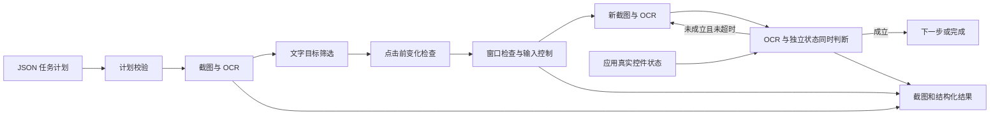

# 感知控制与执行闭环

项目包含感知、控制、流程编排、数据处理和模型接口包，已有脚本保留为各阶段命令行入口。

## 感知层

`gui_perception/pipeline.py` 的 `capture_screen()` 返回原始 RGB 图片与元数据，元数据包含截图区域、显示器信息和物理坐标约定。`create_reader()` 加载一次 EasyOCR Reader，`save_run()` 生成一个独立观察目录。

`normalize_results()` 保留识别框在原图中的位置，并在屏幕截图有已知原点时生成物理桌面坐标。已有图片的桌面坐标为 null，不能直接用于真实点击。

主要结果字段：

| 字段 | 含义 |
|---|---|
| polygon / bbox / center | 相对于原始图片左上角的像素坐标 |
| desktop_polygon / desktop_bbox / desktop_center | 加截图区域偏移后的物理桌面坐标 |
| text / confidence | 识别文字与模型给出的置信度 |
| source.region | 截图区域的 left、top、width、height |

## 控制层

`gui_control/targets.py` 负责匹配与排序，完整匹配时忽略空白、大小写和全半角差异。同名目标需显式选择序号，缺失和重名分别通过 `TargetNotFound`、`AmbiguousTarget` 报告。

`DesktopController` 在发送输入前检查停止状态、鼠标角落停止、目标窗口身份和目标点是否在窗口内。Windows 文本使用 Unicode 输入事件，鼠标、普通按键与快捷键使用 PyAutoGUI，pynput 监听 Escape。

控制日志中的 `sent` 只表示调用已经返回，不能单凭它判断软件状态发生了预期变化。

## 流程编排层

`validate_plan()` 先检查整份任务，强制非空 `expect.state`，返回补齐默认值的副本。`ScreenObserver` 复用 Reader，分别保存 OCR 和独立控件状态；文字点击前重拍目标区域，检查窗口位置和目标图像是否明显变化。`StateFile` 校验状态新鲜度与 HWND；演示程序主线程读取真实控件并导出，未提供适配器时拒绝执行。

`WorkflowRunner` 按步骤观察、执行并检查结果。找不到目标或目标在输入前发生变化时，可以重新观察；一旦开始发送输入，不自动重放，以避免重复输入、重复点击或重复提交。

| 状态字段 | 含义 |
|---|---|
| dispatch_started | 可能已有部分输入发送，不能假设动作完全没有发生 |
| action_sent | 控制调用正常返回 |
| verified | 新截图 OCR 与独立控件状态同时满足预设条件 |
| completed | 全部步骤通过条件确认 |
| failed / aborted | 条件或控制失败，或用户请求中止 |

默认要求预期条件在操作前不成立、操作后成立。等待步骤只观察；显式关闭 transition 的条件仅能说明画面满足要求，不证明变化由当前动作引起。

## 日志和扩展位置

每次运行有独立目录。`summary.json` 保存检查点、分通道验证和分类错误，`events.jsonl` 记录流程事件，`actions.jsonl` 记录输入动作。每次观察保留原图、标注图、OCR JSON 与独立 state.json。状态发布遇到临时访问拒绝时留待下一周期重试，不更新旧时间戳；持续失败仍会触发新鲜度保护。2026-10-26 的 60 项离线测试、两档实际缩放与六组系统场景见 [测试章节](testing.md)；200% 待测。

## 第二周数据与模型接口

`gui_data/` 独立完成官方小样本采集、格式转换、清洗及防泄漏划分，见 [周一完成记录](week2-monday.md)。`gui_agent/` 使用 LangChain Core 将输入准备、HTTP/回放调用、候选校验组合为 RunnableSequence。`agent_cli.py` 接受已有图片或周一数据，保存模型响应与单步候选；它不创建桌面控制器。

模型输入不包含数据集标签；窗口标题及允许的独立状态字段由调用方指定。候选步骤复用 `validate_plan()` 的双重确认契约，同时拒绝模型自建的状态字段与关闭变化检查的动作。候选的 execution_eligible 与 task_verified 均为 false；模型表达 done 不会改变实际任务状态。

当前已用回放和回环 HTTP 模拟服务验证框架与协议，真实模型联调仍待配置。多步任务拆解、实时截图接入和 WorkflowRunner 执行衔接留待周三、周四，详见 [周二完成记录](week2-tuesday.md)。
