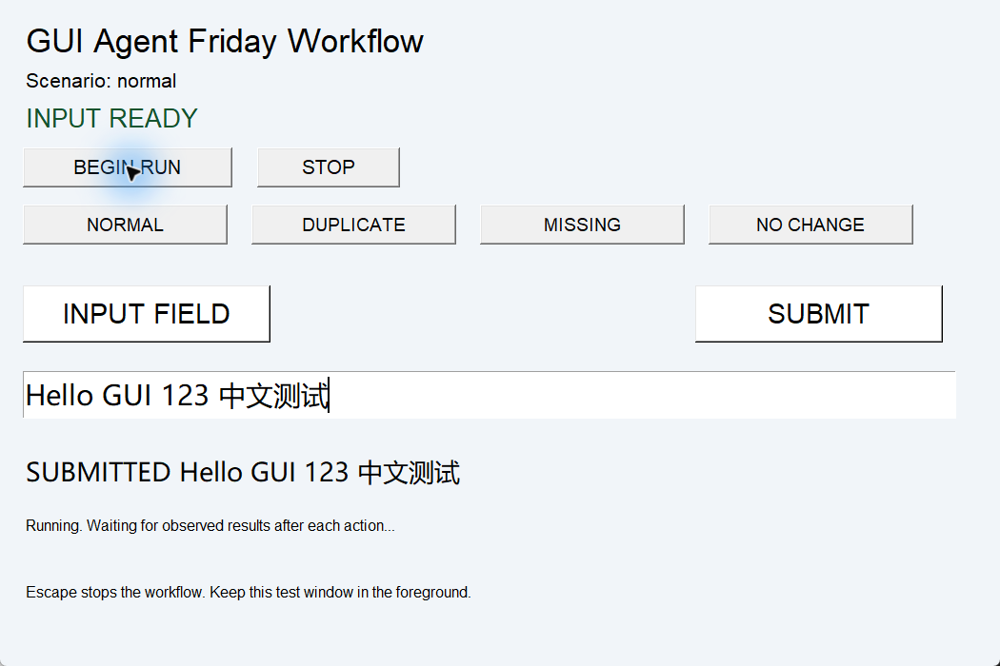
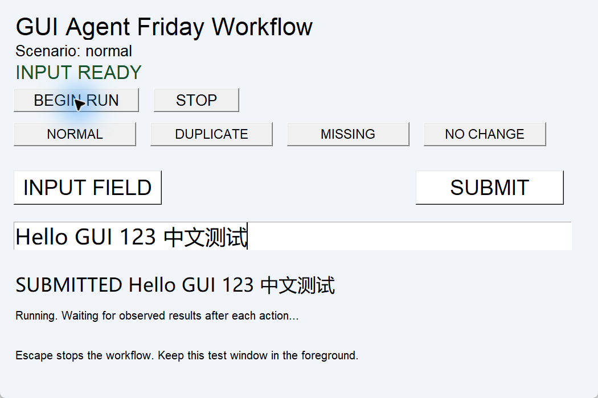
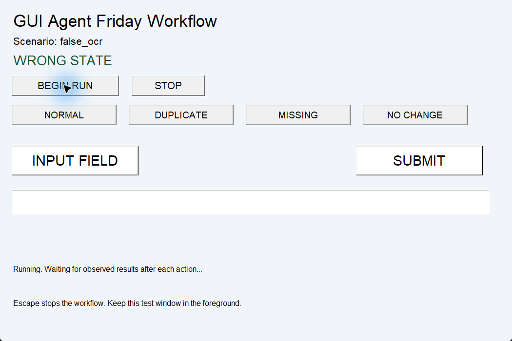
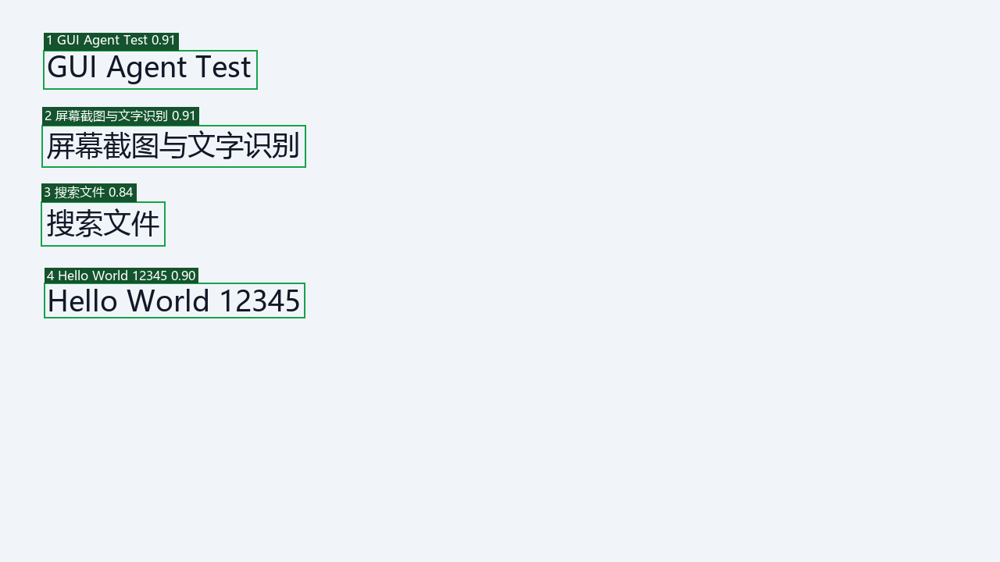
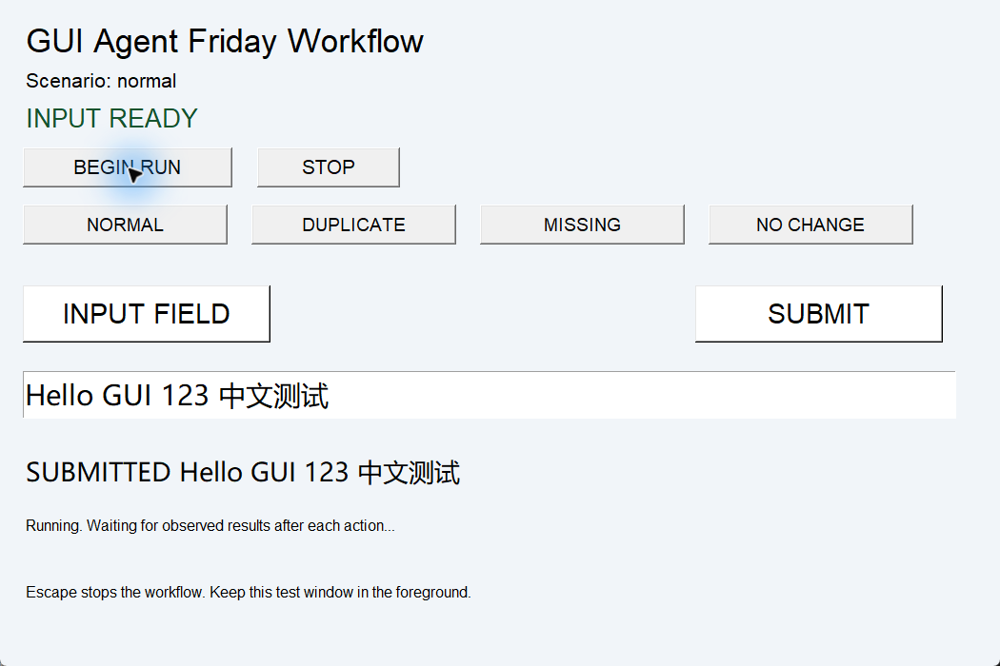
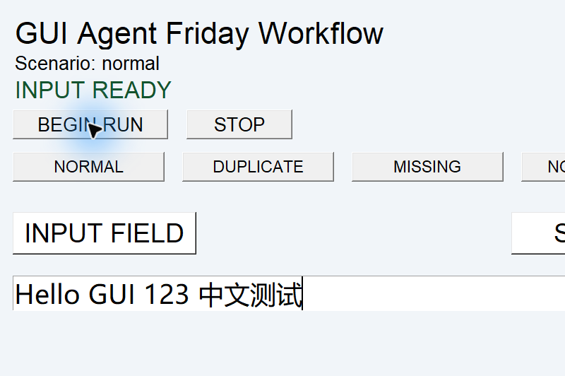

# 测试与实验结果

修订日期：2026 年 10 月 26 日。60 项离线测试通过；同图 OCR 基准完成 3 次新进程冷启动及 30 次热推理。本次真实桌面完成 100% 五场景及 125% 正常三步流程，六组最终均符合预期。125% 首次状态发布异常已修复，原始失败留档；200% 按要求保留待测。

## 测试类型 模块 数量

| 类型 | 功能模块或测试类 | 数量 | 实际结果与范围 |
|---|---|---:|---|
| 单元及离线回归 | 截图坐标 CoordinateTests | 3 | 3 通过 |
| 单元及离线回归 | 输入控制 ControllerTests | 6 | 6 通过 |
| 单元及离线回归 | 文字定位 TargetTests | 5 | 5 通过 |
| 单元及离线回归 | 流程编排 WorkflowTests | 16 | 16 通过 |
| 单元及离线回归 | 双通道判定 DoubleCheckTests | 7 | 7 通过 |
| 单元及离线回归 | 双通道及失败流程 DoubleCheckRunnerTests | 5 | 5 通过 |
| 单元及离线回归 | 状态接口 StateFileTests | 4 | 4 通过 |
| 单元及离线回归 | 状态发布恢复 StatePublisherTests | 3 | 3 通过 |
| 单元及离线回归 | 重名边界 DuplicateEdgeTests | 5 | 5 通过 |
| 单元及离线回归 | 异常分类 FailureCategoryTests | 6 | 6 通过 |
| 系统功能 历史 | OCR 三种图片尺寸及空白图 | 4 张图 | 2026-10-20 留档通过；不是系统缩放 |
| 系统功能 历史 | 点击 输入 滚动 拖拽 | 13 个检查项 | 2026-10-20 留档通过 |
| 系统功能 历史 | 闭环正常与异常场景 | 8 个场景 | 2026-10-20 符合预期；旧版 OCR 单通道 |
| 性能 本次 | OCR 进程冷启动 | 3 次 | 同一输入，新 Python 进程，模型已缓存 |
| 性能 本次 | OCR Reader 热推理 | 30 次 | 3 个 Reader，各首轮后再测 10 次 |
| 系统回归 本次 | 100% 下 normal/duplicate/missing/no_change/false_ocr | 5 个场景 | 均符合预期；异常保护不等于任务成功 |
| 兼容性 本次 | 100% 与 125% 下正常三步流程 | 2 档 | 实测 96 与 120 DPI，双重确认通过 |
| 兼容性 待测 | Windows 显示缩放 200% | 1 档 | 本机预设最高 175%；按要求不应用自定义缩放 |

60 项离线测试只计一次；“回归”是对同一批用例的用途说明。系统按“缩放×场景”去重为 6 组，100% 正常流程同时属于五场景和两档兼容性，不能重复加总。重复执行与首次失败另保存在 run_attempts。离线测试使用 Mock，不生成桌面截图。

本次离线明细：`output/revision/regression/20261026_213006_614989/summary.json`，包含全部 case ID、类、状态与耗时。系统汇总：`output/revision/system-summary.json`，逐组检查动作次数、双通道结果、截图与状态文件、实际 DPI 及分辨率，另列全部 8 次有效执行尝试与 1 次初始化拦截。

## 新版系统测试案例

| 缩放 | 场景 | 预期 | 最后一次实际 |
|---|---|---|---|
| 100% | normal | 三步 OCR 与控件值同时正确 | completed，3 次动作，3 次 verified |
| 100% | duplicate | 两个同名目标不猜测 | AmbiguousTarget，0 次任务动作 |
| 100% | missing | 重新观察三次，无输入 | target_unavailable，0 次任务动作 |
| 100% | no_change | 点击后不满足预期，不重试 | verification_timeout，1 次点击 |
| 100% | false_ocr | 注入 OCR 成功文本，真实控件错误，拒绝成功 | OCR=true、state=false，超时；1 次点击 |
| 125% | normal | 三步双通道确认 | 修复后 completed；3 次动作，3 次 verified |

六组最终均符合预期，不能表述为六个任务都成功。125% 首次失败仍在原目录中；汇总选择每组最后一次完整运行作回归结果，不删除之前失败记录。

## 具体用例

| Case | 前置与输入 | 预期 | 本次实际 |
|---|---|---|---|
| DC01 OCR 错误成功文本 | 注入 OCR=DONE，独立状态=WRONG | 不成功、不重发点击 | 超时，verification_failure，点击 1 次 |
| DC02 OCR 错误拒绝文本 | OCR=WRONG，独立状态=DONE | 不成功 | 双通道整体 false |
| DC03 状态证据缺失 | OCR=DONE，state=None | 不成功 | 双通道整体 false；运行器超时 |
| ST01 状态过期 | 导出文件时间为 10 秒前，上限 2 秒 | 拒绝 | StateUnavailable |
| ST02 状态错窗 | 导出 HWND=456，当前锁定 HWND=123 | 拒绝 | StateUnavailable |
| TG01 两个同名按钮 | 均达到置信度，无 occurrence | 不猜测、不点击 | AmbiguousTarget，0 次点击 |
| TG02 明确第二个 | 两个候选，occurrence=2 | 按本帧几何顺序选第二个 | 点击预期坐标 |
| TG03 完全重合检测框 | 两个同名同框，occurrence=1 | 序号不能消歧，拒绝 | AmbiguousTarget |
| FL01 输入部分失败 | Mock click 抛 RuntimeError | 不重试，保留派发状态 | execution_failure，调用 1 次 |
| FL02 无权限 | Mock click 抛 PermissionError | 单独归类，不重试 | permission_denied，调用 1 次；模拟用例 |
| FL03 失焦 | Mock 检查抛 FocusLost | 停止后续输入 | window_guard_failure，0 次点击 |

DC01 对应 `test_forged_ocr_times_out_without_repeating_input`；FL01、FL02、FL03 对应 DoubleCheckRunnerTests 的独立用例。所有条件与实际断言见 tests/，不依靠人工填写通过标记。

## OCR 冷启动与热启动

同一张 1280×720 图片，中文与英文四行；canvas_size=1600、batch_size=1、workers=0、RTX 5070、PyTorch 2.8.0+cu128。每次推理结束调用 CUDA synchronize，计入 GPU 工作完成。新进程的首次结果为冷路径，Reader 复用后为热路径。模型已下载、操作系统缓存未清理，因此不是重启机器或首次下载模型的耗时。

| 指标 | N | 平均 ms | 中位数 ms | P95 ms | 最小至最大 ms |
|---|---:|---:|---:|---:|---|
| 进程内依赖导入 | 3 | 3673.11 | 1840.99 | 7709.05 | 1469.29–7709.05 |
| Reader 初始化及 EasyOCR 导入 | 3 | 4920.01 | 4182.76 | 7322.03 | 3255.23–7322.03 |
| 首次推理 | 3 | 15669.52 | 15461.83 | 16190.12 | 15356.61–16190.12 |
| 进程内启动到首次结果 | 3 | 24276.39 | 21393.76 | 30511.32 | 20924.10–30511.32 |
| 热推理 | 30 | 343.84 | 361.27 | 385.07 | 157.14–388.68 |

冷启动总计还包括读取图片，始于 worker 函数入口，不包含解释器启动前的时间；不是各列中位数相加。P95 使用 nearest rank，3 个冷样本的 P95 实际等于最大值，不能视作稳定尾延迟估计。后台负载未隔离，无 CPU 对照或跨硬件结论。`process_wall_ms` 含热推理及进程退出，不能当作冷启动。

原始逐进程与逐次采样：`output/revision/benchmark/20261026_203843_946808/`。此前 15133.90/257.62/237.27 ms 是三个不同图片的单次值，保留为历史数据，不用来比较分辨率性能或计算本次冷热差异。

## 新版实际截图

100% 恢复后的正常流程，实际窗口 96 DPI，分辨率 1920×1080。

125% 下正常流程，实际窗口 120 DPI，分辨率仍为 1920×1080，截图中的文字渲染实际改变。

真实状态为 WRONG STATE，results.json 中显式注入 INPUT READY，独立状态阻止误判。该实验不是自然发生的 OCR 误识别。

## 历史截图

下列均为 2026-10-20 独立测试窗口的真实截图，不是重新绘制的效果图，也不是本次新版执行证据。

图 1：三种图片尺寸测试之一，图中文字正确不代表系统 DPI 缩放通过。

图 2：旧版正常提交后的输入框与 SUBMITTED 回显。旧版流程只用 OCR 判断 verified。

## Windows 显示缩放验证矩阵

| Windows 缩放 | 目标 DPI | 分辨率约束 | 需要确认的内容 | 状态 |
|---|---:|---|---|---|
| 100% | 96 实测 | 同一主屏 1920×1080 | 正常三步及四类异常；含恢复后的正常回归 | 通过 |
| 125% | 120 实测 | 同上 | 正常三步，OCR 与控件状态同时确认 | 修复后通过 |
| 200% | 192 | 同上 | 同上，检查布局截断及坐标虚拟化 | 待测 |

执行时在 Windows 设置中修改真实显示缩放，重启测试窗口，记录 `GetDpiForWindow`、截图尺寸、目标框及点击坐标。不得修改图片尺寸代替系统缩放。每档先测 normal 三步，再运行异常场景；未通过时按定位、执行、确认或权限等分类。测试后恢复原缩放值。

`scripts/test_display_scaling.py --scale 125` 仅启动测试，不修改系统设置；friday_demo.py 会检查实际窗口 DPI，若与请求档位不符，输入前失败。本次直接运行演示程序的 `--expected-scale 125` 与 `--expected-scale 100`，系统设置通过真实 Windows 显示页面切换。125% 未补测四类异常场景。结束后已恢复原 100%，新窗口 96 DPI 及正常流程均再次确认。

当前 Windows 预设只有 100%、125%、150%、175%，200% 需自定义缩放，可能涉及注销；按用户要求未应用自定义设置，200% 保留待测。

## 真实失败 修复及重测

125% 首次运行 `output/revision/system/scale-125/20261026_212909_983255/summary.json`：第一步已通过双重确认；Windows 在原子替换状态文件时返回 PermissionError WinError 5，发布回调退出，后续状态超过 2 秒，运行器 StateUnavailable，未误报成功。原始记录不改写。

此图为失败现场局部截图，仅裁去测试窗口外的区域，保留区像素未改；裁剪范围记录在 failure-analysis.json。

修复：发布遇到 PermissionError 只跳过本次写入，40 ms 后再尝试，旧快照的值与时间戳保持不变；持续失败仍会被新鲜度检查拒绝，不掩盖故障。重测 125% 时再次出现 1 次发布拒绝，发布循环恢复，三步通过。补充 3 项离线回归：临时失败可恢复、失败不刷新旧快照、其他磁盘异常不静默吞掉。没有确定具体占用者，也未据此推断管理员权限差异。

## 失败统计与限制

旧版 8 场景中正常 GUI 与 CLI 各 1 个完成，其余为预期防护：定位失败 2 个（重名、缺失）、确认失败 1 个（超时）、主动中止 2 个（Esc、STOP）、窗口保护 1 个（失焦）。这是对历史错误码的分析归类，未改写原始日志。没有观察到真实权限拒绝，也没有把模拟权限测试当作真实系统权限验证。

本次离线 60 项用例全部符合断言。新版最终六组系统场景中，两个正常场景完成、两个定位失败与两个确认失败均符合防护预期。125% 首次状态发布失败另行列出；一次初始化尝试被 FocusLost 拦截也保留在系统汇总中，不计作已执行完整场景。

完整失败类别、重名规则和状态适配器限制见 [验证规则](verification-and-target-rules.md)。
