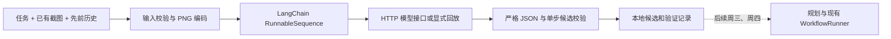

# 第二周周二：Agent 框架与多模态模型接口

完成日期：2026 年 10 月 27 日（Australia/Sydney）。对应个人计划中的“选用 LangChain 或 LlamaIndex 搭建基础框架，开发多模态模型本地或 API 调用接口”。

本阶段已实现 LangChain Core 1.7.0 的基础调用链、多模态 HTTP 客户端、离线回放客户端、输入与输出校验、周一数据读取及命令行入口；包括后续中断修复在内，新增 35 项测试和 7 组集成验证通过，全项目 118 项回归通过。用户已选择 NVIDIA NIM；首次真实请求读超时后被中断，真实模型联调和生成质量验收仍保留待测，见 [NIM 排查记录](nim-troubleshooting.md)。

配套文档：[任务使用说明](../第二周周二任务使用说明.md) · [任务验证记录](../第二周周二任务验证记录.md) · [机器可读验证摘要](../output/week2-tuesday/verification.json)。

## 实现范围

LangChain 采用 `RunnableLambda | RunnableLambda | RunnableLambda` 组合，分别处理输入、调用和解析；沿用其 [RunnableSequence 官方接口](https://reference.langchain.com/python/langchain-core/runnables/base/RunnableSequence)。HTTP 使用标准库，按 [vLLM 官方兼容服务说明](https://github.com/vllm-project/vllm/blob/main/docs/serving/online_serving/openai_compatible_server.md) 的消息结构发送文本和 `image_url` 图片内容；本机本轮未安装或部署 vLLM。

接口面向已部署的视觉模型服务：本地使用 loopback HTTP，远程使用 HTTPS。它不负责加载本地模型权重；服务需支持 `/chat/completions`、文本与 PNG data URL 输入、非流式文本响应及相应采样参数。其他服务协议需要后续适配，不能假定任意模型都兼容。

## 新增入口与约定

| 文件 | 用途 |
|---|---|
| `agent_cli.py` | 合成演示、已有图片、周一数据三种输入模式 |
| `gui_agent/contracts.py` | 输入边界、图片编码、无标签数据读取、候选校验 |
| `gui_agent/client.py` | HTTP 请求、鉴权、超时、响应大小限制、错误分类与回放 |
| `gui_agent/agent.py` | LangChain 调用链、输出落盘、关闭外部 tracing |
| `requirements-agent.txt` | 固定 `langchain-core==1.7.0`，已纳入总依赖 |
| `tests/test_agent.py` | 35 项离线测试，含中断状态与退出码修复 |
| `scripts/validate_week2_tuesday.py` | 记录逐例结果，并以本地 HTTP 模拟服务验证接口 |

窗口标题和可用独立状态字段由调用方提供。模型只能返回 `propose`、`clarify` 或 `done`；候选步骤复用现有 workflow 的动作和 OCR+独立状态要求。未知状态字段、原始坐标、脚本/命令和关闭变化检查的动作均被拒绝。此阶段候选输出不自动执行，`done` 也不表示任务已被独立验证。

周一数据读取先审计处理目录，再取 `instruction`、图像和 `history_before`，不把 `label`、当前/未来动作、评测答案或来源系统提示拼入模型输入。长历史超出边界时明确拒绝，不静默裁剪。

## 当前验收结论

- 框架可实际运行：离线回放、命令行演示及本地 HTTP 正常响应均生成候选记录。
- HTTP 模拟验证实际比对 PNG 字节、中文任务和鉴权头，覆盖 401、429、错误 JSON 和截断响应；每次仅请求一次。
- 真实数据接入验证使用周一的公开截图和回放澄清答案，验证的是输入管线。
- 新增 35 项测试及全项目 118 项回归、计划、依赖和历史证据检查通过。历史 8 份桌面证据未重新执行。
- 真实模型调用、GPU 推理性能、实际任务规划质量与桌面闭环尚未验收；周三、周四继续在本接口上实现任务拆解与执行集成。
