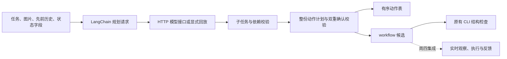

# 第二周周三：任务拆解与动作生成

完成日期：2026 年 10 月 27 日（Australia/Sydney）。对应个人计划“实现简单任务拆解与动作表示，测试任务规划和动作生成流程”。

已在周二 LangChain 接口上增加多步规划模式：模型返回子任务、依赖与步骤，程序校验整份计划，生成有序动作表和兼容现有 workflow 的候选文件。新增 30 项测试、11 组集成验证通过，全项目 148 项测试通过。真实 NIM 模型生成质量仍待测；本阶段验证使用回放、本地 HTTP 模拟服务和已有公开截图，未操作桌面。

配套文档：[使用说明](../第二周周三任务使用说明.md) · [验证记录](../第二周周三任务验证记录.md) · [机器可读验证摘要](../output/week2-wednesday/verification.json)。

## 实现与调用流程



| 文件 | 用途 |
|---|---|
| `gui_agent/planner.py` | 规划提示、子任务/依赖/动作契约、候选编译与 GuiPlanner |
| `gui_agent/agent.py` | 复用请求、LangChain、落盘、脱敏及中断处理；保留周二单步模式 |
| `agent_cli.py --mode plan` | 多步规划入口，默认仍为周二单步模式 |
| `docs/agent-plan.example.json` | 三子任务、三动作的固定模型回放示例 |
| `docs/agent-plan-clarify.example.json` | 缺少实时状态适配器时的澄清示例 |
| `tests/test_planner.py` | 23 项契约测试、7 项管线及 CLI 测试 |
| `scripts/validate_week2_wednesday.py` | 11 组规划集成验证与逐例记录 |

无需安装新依赖，继续使用已有 LangChain Core 1.7.0、Pillow 与 Python 标准库。

## 实际示例

```powershell
.\.venv\Scripts\python.exe agent_cli.py --mode plan --demo
```

任务“聚焦输入框，输入 Hello GUI 123 中文测试，点击提交”编译为：

| 顺序 | 子任务 | 依赖 | 动作 | 预期独立状态 |
|---:|---|---|---|---|
| 1 | focus | 无 | click_text：INPUT FIELD | input_focused、status |
| 2 | enter | focus | type_text：原始中英文文本 | entry_text |
| 3 | submit | enter | click_text：SUBMIT | submitted、submit_enabled |

每一步还必须有预期 OCR 文本。子任务按数组顺序串行编译，依赖只能指向此前子任务；不自动重排、不执行并行任务。默认最多 12 个动作，可设为 1～32；最多 8 个子任务。全部步骤通过后才导出候选，不能先执行前几步再发现后续非法。

当前规划提示及接口支持模型生成多步结构；离线示例答案是固定回放，不是本地自然语言理解算法或真实模型效果证明。生成后的 `plan_ready` 仅表示结构校验通过，独立任务验收仍为 false。

## 当前边界

周三完成静态规划、动作表示及与现有计划格式的兼容校验；实时截图、目标重新定位、实际输入和反馈闭环在周四实现。本阶段的候选文件没有绑定新鲜的桌面窗口状态，不应直接当作已确认可执行的计划。

真实模型联调沿用 [NIM 排查记录](nim-troubleshooting.md) 的待测状态。没有再次发出真实 NIM 请求，也未开展 GUI 成功率、系统缩放或模型性能测试。
